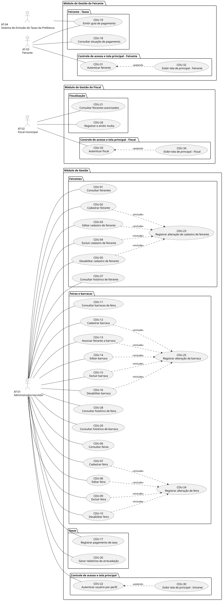

# Visão da Demanda (VD) — Sistema de Gestão das Feiras Livres de Fortaleza

> **Exemplo didático preenchido conforme o template LAPIS v2.1.** Base documental: [Solicitação da Prefeitura](PropostaFeiraLivre.md), [VD anterior](exemplo-feira-livre-visao.md) e **Código da Cidade de Fortaleza (LC nº 270/2019, com alterações da LC nº 286/2020)**, especialmente arts. 556–565 e 707. O texto legal consultado integra a documentação do exercício; sua vigência consolidada e eventuais regulamentações posteriores devem ser verificadas com a assessoria jurídica municipal. Valores, frequência e demais avaliações herdadas da VD anterior são classificações do exemplo, **não aprovações da Prefeitura**. Fluxos e testes são detalhados em artefatos próprios.

## Identificação e Histórico

| Campo                           | Informação                                                                                               |
| ------------------------------- | ---------------------------------------------------------------------------------------------------------- |
| Nome e identificador da demanda | Sistema de Gestão das Feiras Livres de Fortaleza — código a definir                                     |
| Tipo                            | Novo sistema                                                                                               |
| Sistema ou produto relacionado  | Novo Sistema de Gestão das Feiras Livres de Fortaleza                                                     |
| Área solicitante               | Prefeitura de Fortaleza — Secretaria Municipal responsável pelas feiras (denominação formal a definir) |
| Responsável pela elaboração  | Equipe LAPIS (conforme VD original)                                                                        |
| Responsável pela validação   | A definir pela Prefeitura                                                                                  |
| Situação do documento         | Em revisão — exemplo didático sem aprovação formal                                                    |
| Versão e data                  | 1.2 — 12/10/2026 (revisão normativa sobre feiras livres)                                                 |

| Data       | Versão | Descrição da alteração                                                                               | Autor                                                           |
| ---------- | ------- | -------------------------------------------------------------------------------------------------------- | --------------------------------------------------------------- |
| 12/04/2026 | 1.0     | Criação inicial, conforme VD anterior                                                                  | Equipe LAPIS                                                    |
| 12/10/2026 | 1.1     | Reorganização no template LAPIS v2.1; rastreabilidade com solicitação original; lacunas explicitadas | Adaptação assistida por IA — requer revisão da equipe LAPIS |

| 12/10/2026 | 1.2 | Alinhamento normativo com o Código da Cidade; requisitos e pendências legais rastreados por artigo | Adaptação assistida por IA — sujeita à validação jurídica e de negócio |

## 1. Objetivo

Apoiar a Secretaria Municipal responsável na **gestão das feiras livres de Fortaleza**, mediante registro e acompanhamento de feiras, feirantes, barracas e taxas, oferecendo aos fiscais consulta aos feirantes autorizados e apoio à fiscalização, inclusive ao registro e à emissão de multas quando cabíveis, conforme competência, base legal e procedimento a validar.

## 2. Contexto, Problema e Descrição Sumária da Demanda

- **Situação atual:** o controle de feirantes, a organização das barracas, as autorizações e o pagamento de taxas são feitos manualmente ou por planilhas, conforme a solicitação da Prefeitura.
- **Problema ou oportunidade:** essas práticas dificultam o controle administrativo e a fiscalização e motivam a modernização da gestão das feiras.
- **Públicos afetados e impactos:** Secretaria Municipal (gestão), fiscais (consulta e fiscalização) e feirantes (cadastros e consulta da própria situação de pagamento e emissão de guias).
- **Evidências disponíveis:** [PropostaFeiraLivre.md](PropostaFeiraLivre.md), contexto e itens 1 a 18; [VD original](exemplo-feira-livre-visao.md), catálogo e representações. Não foram fornecidas métricas da situação atual. **Base legal:** Código da Cidade (LC 270/2019, alterada pela LC 286/2020), arts. 556–565 e, em contextos específicos de adoção de espaços, art. 707.
- **Descrição sumária da demanda:** solução acessível em navegadores web modernos para manter cadastros de feirantes, registrar feiras e barracas, controlar pagamentos de taxas, permitir que o feirante consulte sua situação e emita guias, emitir relatórios mensais de arrecadação, apoiar a consulta e fiscalização pelos fiscais e registrar/emitir multas quando cabíveis, controlando o acesso conforme as funções autorizadas e o histórico de alterações. A base legal, competência e procedimento para multas precisam ser confirmados antes de detalhar essa função. O processamento de pagamento eletrônico não está confirmado. O código municipal exige cadastro prévio do feirante e autorização para a atividade, além de disciplinar identificação, localização e organização das bancas; a automação dessas rotinas dependerá de decisão de escopo.

## 3. Proposta de Valor e Sucesso da Demanda

| Benefício esperado                                | Indicador ou evidência                                                                                  | Resultado desejado                                                                | Como e quando avaliar                                                                                                                                   |
| -------------------------------------------------- | -------------------------------------------------------------------------------------------------------- | --------------------------------------------------------------------------------- | ------------------------------------------------------------------------------------------------------------------------------------------------------- |
| Melhorar o controle dos feirantes e barracas       | Disponibilidade e consistência dos registros por feira Percentual de feiras cadastradas no sistema | Cadastro e vinculação de barracas utilizáveis pela Secretaria                  | Conferência com representantes da Secretaria na homologação; Meta quantitativa a definir com a Secretaria (não consta da solicitação nem da lei). |
| Facilitar a fiscalização                         | Consulta aos feirantes autorizados por feira                                                             | Fiscais conseguem consultar os registros necessários                             | Validação funcional com fiscais; critérios detalhados no respectivo CDU                                                                              |
| Apoiar a gestão de taxas                          | Registro de pagamentos e relatórios mensais de arrecadação                                            | Secretaria obtém relatórios mensais por feira                                   | Verificação com dados de teste e avaliação pelo setor responsável                                                                                  |
| Facilitar o acompanhamento das taxas pelo feirante | Consulta da situação de pagamento e emissão de guias                                                  | Feirante consegue consultar suas próprias informações e emitir guias           | Validação com feirantes após a entrega; forma de emissão e integração a detalhar                                                                  |
| Melhorar a rastreabilidade administrativa          | Histórico de alterações dos cadastros de feirantes, feiras e barracas                                 | Alterações cadastrais podem ser consultadas/auditadas conforme regras a definir | Revisão das evidências de histórico durante homologação                                                                                            |

> As metas numéricas de benefício e a linha de base **não constam dos documentos de origem**; precisam ser levantadas. O limite de três segundos é condição de qualidade, não meta de benefício.

## 4. Partes Interessadas

| Parte interessada                              | Papel e interesse                                    | Responsabilidade                                                                     | Representante                                                         |
| ---------------------------------------------- | ---------------------------------------------------- | ------------------------------------------------------------------------------------ | --------------------------------------------------------------------- |
| Prefeitura de Fortaleza / Secretaria Municipal | Solicitante e gestora das feiras                     | Definir e validar necessidades e regras operacionais; gerenciar feiras e cadastros   | Ana Lima (identificada na VD anterior; representação a confirmar)   |
| Feirantes                                      | Usuários das funcionalidades financeiras incluídas | Consultar a própria situação de pagamento e emitir guias; manter-se regularizados | Feirante Humberto                                                     |
| Fiscal Municipal                               | Usuário de fiscalização                           | Consultar a regularidade de feirantes por feira                                      | José Silva (Chefe do setor de fiscalização de feira da Ragional 1) |
| Equipe de desenvolvimento                      | Construção e manutenção                          | Especificar, implementar e testar a solução contratada                             | Equipe LAPIS (VD anterior; atribuição real a confirmar)             |

## 5. Usuários e Atores Externos

| ID    | Usuário, sistema ou dispositivo               | Objetivo ou papel na interação                                                        | Contexto de uso relevante                                                                           |
| ----- | ---------------------------------------------- | --------------------------------------------------------------------------------------- | --------------------------------------------------------------------------------------------------- |
| AT-01 | Administrador/servidor da Secretaria Municipal | Manter cadastros, feiras, barracas, pagamentos e relatórios                            | Acesso às funções administrativas autenticadas                                                   |
| AT-02 | Fiscal Municipal                               | Consultar feirantes autorizados numa feira                                              | Consulta de apoio à fiscalização                                                                 |
| AT-03 | Feirante                                       | Consultar sua situação de pagamento e emitir guia para pagamento das taxas municipais | Acesso autenticado às próprias informações e guias; pagamento eletrônico não está confirmado |
| AT-04 | Sistema de Emissão de Taxas da Prefeitura     | Emitir taxas municipais vinculadas aos feirantes                                        | Sistema externo identificado; interface e fluxo de integração a detalhar                          |

> Personas do Feirante e do Fiscal aparecem na VD anterior. Seu detalhamento é opcional e não precisa ser duplicado neste documento.

## 6. Escopo e Entregas Previstas

### 6.1. Incluído na demanda

- Consulta/listagem, cadastro, edição, exclusão e desativação de feirantes.
- Listagem, cadastro, edição, exclusão e desativação de feiras.
- Listagem das barracas de uma feira e cadastro, edição, exclusão e desativação de barracas. O cadastro de uma barraca não exige associação imediata a um feirante; essa associação pode ser feita posteriormente.
- Registro de pagamentos de taxas municipais, consulta pelos feirantes da própria situação de pagamento, emissão de guias para pagamento e relatórios mensais de arrecadação.
- Consulta, pelos fiscais, dos feirantes autorizados para uma feira e emissão de multa a feirante quando cabível.
- Autenticação para funcionalidades administrativas e para acesso do feirante às próprias informações financeiras.
- Registro e consulta do histórico de alterações dos cadastros de feirantes, feiras e barracas, conforme regras a detalhar.
- Atendimento às condições de uso via navegador, desempenho, base de dados e conformidade descritas na seção 9.
- **Candidato a adequação legal (não aprovado como nova funcionalidade):** registrar referências a autorizações e respectivas situações, localização e numeração de bancas e informações úteis à fiscalização da ocupação, observados os arts. 561–565. A inclusão e os critérios serão decididos pela Secretaria na elicitação complementar.

### 6.2. Fora do escopo

- Acesso público dos contribuintes aos dados das feiras. Permanecem incluídas as consultas operacionais dos fiscais e, com autenticação, as consultas e emissão de guias pelo próprio feirante previstas na seção 6.1.
- O processamento de pagamentos eletrônicos pelo sistema não está incluído nem confirmado. Solicitação/emissão de licenças e outras funções de autosserviço dos feirantes ainda precisam de decisão (seção 10).

### 6.3. Evoluções futuras — opcionais

- **Sem evolução futura aprovada.** A VD anterior apresenta solicitar licença, pagar taxa e consultar próxima feira pelo feirante, além de configurar feira e emitir licença pela Secretaria. São **candidatas à avaliação**, não entregas comprometidas nem evoluções confirmadas.

### 6.4. Entregas e marcos — quando conhecidos

| Entrega ou marco           | Resultado previsto                                                                                        | Data ou condição                                          | Natureza do prazo                                                          |
| -------------------------- | --------------------------------------------------------------------------------------------------------- | ----------------------------------------------------------- | -------------------------------------------------------------------------- |
| Validação dos requisitos | Requisitos detalhados das funcionalidades incluídas no escopo, revisados e validados pelos responsáveis | Até dois meses após a aprovação desta Visão da Demanda | Prazo definido                                                             |
| Desenvolvimento do sistema | Sistema com as capacidades acordadas                                                                      | Até 6 meses após contratação                            | Prazo máximo**estimado** na solicitação; detalhamento a confirmar |
| Homologação e aceite     | Verificação com responsáveis da Prefeitura                                                             | A definir                                                   | Marco proposto para planejamento; sem data definida                        |

## 7. Necessidades e Catálogo de Funcionalidades

**Fontes:** `PF-01` = [PropostaFeiraLivre.md](PropostaFeiraLivre.md), itens numerados; `VD-1.0` = [exemplo anterior](exemplo-feira-livre-visao.md). IDs `NEC-` e `F-` são novos identificadores estáveis do exemplo 2.1; a coluna de especificação registra o **CDU a elaborar**, sem afirmar que o arquivo exista.

| ID     | Necessidade                                                                                                                | Fonte ou evidência                                                                         | Públicos ou atores relacionados |
| ------ | -------------------------------------------------------------------------------------------------------------------------- | ------------------------------------------------------------------------------------------- | -------------------------------- |
| NEC-01 | Manter registros atualizados dos feirantes                                                                                 | PF-01 itens 1 e 6                                                                           | AT-01, AT-03                     |
| NEC-02 | Gerenciar feiras e barracas por localidade                                                                                 | PF-01 itens 2, 15 e 17; VD-1.0                                                              | AT-01, AT-03                     |
| NEC-03 | Controlar pagamentos e arrecadação de taxas, permitindo ao feirante consultar sua situação e emitir guias de pagamento | PF-01 itens 4, 5 e 16; necessidade informada pelo solicitante                               | AT-01, AT-03, AT-04              |
| NEC-04 | Apoiar a fiscalização de participantes autorizados e a emissão de multas a feirantes quando cabível                    | PF-01 itens 3 e 14; emissão de multa informada pelo solicitante                            | AT-02, AT-01                     |
| NEC-05 | Controlar o acesso às funcionalidades conforme os perfis autorizados                                                      | PF-01 itens 9 e 10; necessidade de acesso financeiro do feirante informada pelo solicitante | AT-01, AT-02, AT-03              |
| NEC-06 | Manter histórico das alterações cadastrais para consulta e rastreabilidade                                              | VD-1.0; necessidade distinta do controle de acesso                                          | AT-01                            |

| ID   | Funcionalidade e resultado esperado                                                                                            | Necessidade | Atores (IDs)        | Prioridade | Valor     | Frequência                         | Escopo ou entrega | Especificação                                                                                                                                                                                                                                                                                                                                                        |
| ---- | ------------------------------------------------------------------------------------------------------------------------------ | ----------- | ------------------- | ---------- | --------- | ----------------------------------- | ----------------- | ---------------------------------------------------------------------------------------------------------------------------------------------------------------------------------------------------------------------------------------------------------------------------------------------------------------------------------------------------------------------- |
| F-01 | Consultar e listar feirantes cadastrados                                                                                       | NEC-01      | AT-01               | A definir  | A definir | A definir                           | Incluída         | CDU-01 — Consultar feirantes (a elaborar)                                                                                                                                                                                                                                                                                                                             |
| F-02 | Cadastrar feirante com nome, CPF, produto e telefone                                                                           | NEC-01      | AT-01               | A definir  | Alto      | Alta                                | Incluída         | CDU-02 — Cadastrar feirante (a elaborar)                                                                                                                                                                                                                                                                                                                              |
| F-03 | Editar os dados cadastrais de um feirante                                                                                      | NEC-01      | AT-01               | A definir  | Médio    | Média                              | Incluída         | CDU-03 — Editar cadastro de feirante (a elaborar)                                                                                                                                                                                                                                                                                                                     |
| F-04 | Excluir o cadastro de um feirante                                                                                              | NEC-01      | AT-01               | A definir  | Médio    | Média                              | Incluída         | CDU-04 — Excluir cadastro de feirante (a elaborar)                                                                                                                                                                                                                                                                                                                    |
| F-05 | Desabilitar o cadastro de um feirante                                                                                          | NEC-01      | AT-01               | A definir  | A definir | A definir                           | Incluída         | CDU-05 — Desabilitar cadastro de feirante (a elaborar)                                                                                                                                                                                                                                                                                                                |
| F-06 | Consultar e listar feiras                                                                                                      | NEC-02      | AT-01               | A definir  | A definir | A definir                           | Incluída         | CDU-06 — Consultar feiras (a elaborar)                                                                                                                                                                                                                                                                                                                                |
| F-07 | Cadastrar feira por bairro                                                                                                     | NEC-02      | AT-01               | A definir  | Alto      | Média                              | Incluída         | CDU-07 — Cadastrar feira (a elaborar)                                                                                                                                                                                                                                                                                                                                 |
| F-08 | Editar os dados de uma feira                                                                                                   | NEC-02      | AT-01               | A definir  | A definir | A definir                           | Incluída         | CDU-08 — Editar feira (a elaborar)                                                                                                                                                                                                                                                                                                                                    |
| F-09 | Excluir uma feira                                                                                                              | NEC-02      | AT-01               | A definir  | A definir | A definir                           | Incluída         | CDU-09 — Excluir feira (a elaborar)                                                                                                                                                                                                                                                                                                                                   |
| F-10 | Desabilitar uma feira                                                                                                          | NEC-02      | AT-01               | A definir  | A definir | A definir                           | Incluída         | CDU-10 — Desabilitar feira (a elaborar)                                                                                                                                                                                                                                                                                                                               |
| F-11 | Consultar e listar barracas de uma feira                                                                                       | NEC-02      | AT-01               | A definir  | A definir | A definir                           | Incluída         | CDU-11 — Consultar barracas da feira (a elaborar)                                                                                                                                                                                                                                                                                                                     |
| F-12 | Cadastrar barraca em uma feira                                                                                                 | NEC-02      | AT-01               | A definir  | Alto      | Alta                                | Incluída         | CDU-12 — Cadastrar barraca (a elaborar)                                                                                                                                                                                                                                                                                                                               |
| F-13 | Associar um feirante a uma barraca                                                                                             | NEC-02      | AT-01               | A definir  | A definir | A definir                           | Incluída         | CDU-13 — Associar feirante a barraca (a elaborar)                                                                                                                                                                                                                                                                                                                     |
| F-14 | Editar os dados de uma barraca                                                                                                 | NEC-02      | AT-01               | A definir  | A definir | A definir                           | Incluída         | CDU-14 — Editar barraca (a elaborar)                                                                                                                                                                                                                                                                                                                                  |
| F-15 | Excluir uma barraca                                                                                                            | NEC-02      | AT-01               | A definir  | A definir | A definir                           | Incluída         | CDU-15 — Excluir barraca (a elaborar)                                                                                                                                                                                                                                                                                                                                 |
| F-16 | Desabilitar uma barraca                                                                                                        | NEC-02      | AT-01               | A definir  | A definir | A definir                           | Incluída         | CDU-16 — Desabilitar barraca (a elaborar)                                                                                                                                                                                                                                                                                                                             |
| F-17 | Registrar pagamento de taxa municipal                                                                                          | NEC-03      | AT-01               | A definir  | Alto      | Alta                                | Incluída         | CDU-17 — Registrar pagamento de taxa (a elaborar)                                                                                                                                                                                                                                                                                                                     |
| F-18 | Consultar a própria situação de pagamento das taxas municipais pelo feirante                                                | NEC-03      | AT-03               | A definir  | A definir | A definir                           | Incluída         | CDU-18 — Consultar situação de pagamento (a elaborar)                                                                                                                                                                                                                                                                                                               |
| F-19 | Emitir guia para pagamento das taxas municipais do feirante                                                                    | NEC-03      | AT-03, AT-04        | A definir  | A definir | A definir                           | Incluída         | CDU-19 — Emitir guia de pagamento (a elaborar)                                                                                                                                                                                                                                                                                                                        |
| F-20 | Gerar relatórios mensais de arrecadação por feira                                                                           | NEC-03      | AT-01               | A definir  | Alto      | Baixa (mensal)                      | Incluída         | CDU-20 — Gerar relatórios de arrecadação (a elaborar)                                                                                                                                                                                                                                                                                                              |
| F-21 | Consultar feirantes autorizados em uma feira                                                                                   | NEC-04      | AT-02               | A definir  | Alto      | Alta                                | Incluída         | CDU-21 — Consultar feirantes autorizados (a elaborar)                                                                                                                                                                                                                                                                                                                 |
| F-22 | Autenticar usuários conforme suas funções autorizadas, incluindo acesso do feirante às próprias informações financeiras | NEC-05      | AT-01, AT-02, AT-03 | A definir  | Alto      | Alta (por acesso, a confirmar)      | Incluída         | CDU-22 — Autenticar usuário por perfil - Intranet (a elaborar) CDU-30 — Exibir tela de principal - Intranet (a elaborar) CDU-31 — Autenticar feirante (a elaborar) CDU-32 — Exibir tela de principal - Feirante (a elaborar)  CDU-33 — Autenticar fiscal (a elaborar) CDU-34 — Exibir tela de principal - Fiscal (a elaborar) |
| F-23 | Registrar histórico de alterações do cadastro de feirantes                                                                  | NEC-06      | AT-01               | A definir  | Médio    | Alta (por alteração, a confirmar) | Incluída         | CDU-23 — Registrar alteração de cadastro de feirante (a elaborar)                                                                                                                                                                                                                                                                                                   |
| F-24 | Registrar histórico de alterações dos dados das feiras                                                                      | NEC-06      | AT-01               | A definir  | A definir | A definir                           | Incluída         | CDU-24 — Registrar alteração de feira (a elaborar)                                                                                                                                                                                                                                                                                                                  |
| F-25 | Registrar histórico de alterações dos dados das barracas                                                                    | NEC-06      | AT-01               | A definir  | A definir | A definir                           | Incluída         | CDU-25 — Registrar alteração de barraca (a elaborar)                                                                                                                                                                                                                                                                                                                |
| F-26 | Registrar e emitir multa a feirante por infração constatada em fiscalização                                                | NEC-04      | AT-02               | A definir  | A definir | A definir                           | Incluída         | CDU-26 — Registrar e emitir multa (a elaborar)                                                                                                                                                                                                                                                                                                                        |
| F-27 | Consultar o histórico de alterações do cadastro de feirantes                                                                | NEC-06      | AT-01               | A definir  | A definir | A definir                           | Incluída         | CDU-27 — Consultar histórico de feirante (a elaborar)                                                                                                                                                                                                                                                                                                                |
| F-28 | Consultar o histórico de alterações dos dados das feiras                                                                    | NEC-06      | AT-01               | A definir  | A definir | A definir                           | Incluída         | CDU-28 — Consultar histórico de feira (a elaborar)                                                                                                                                                                                                                                                                                                                   |
| F-29 | Consultar o histórico de alterações dos dados das barracas                                                                  | NEC-06      | AT-01               | A definir  | A definir | A definir                           | Incluída         | CDU-29 — Consultar histórico de barraca (a elaborar)                                                                                                                                                                                                                                                                                                                 |

> **Valor e frequência:** estimativas do exemplo anterior (alta/média/mensal/sempre), adaptadas à escala qualitativa v2.1. A prioridade não estava explicitamente definida e permanece **A definir**. Para F-22/F-23, “sempre” no exemplo anterior expressava ocorrência condicionada ao evento, e não volume medido; a frequência precisa de validação. A forma de emissão da guia, a atualização da situação de pagamento e eventual processamento eletrônico do pagamento precisam ser detalhados; emissão de guia não significa que o sistema processe o pagamento. Os valores de F-06, F-08 a F-11, F-13 a F-16, F-18, F-19 e F-24 a F-29 permanecem **A definir** por falta de estimativa validada. As regras de exclusão e desativação de feirantes, feiras e barracas devem ser detalhadas nas especificações, sem presumir que tenham o mesmo comportamento. A base legal, as infrações sujeitas a multa, os valores e o procedimento de emissão precisam ser confirmados antes de especificar F-26.

> **Candidatas sem inclusão confirmada:** solicitação ou emissão de licença, pagamento eletrônico pelo feirante, consulta da próxima feira e configuração de feira aparecem no diagrama da VD 1.0, mas não constam de forma inequívoca como funções exigidas nas fontes consultadas. Não receberam identificadores `F-` até haver decisão de escopo.

## 8. Visão Geral da Solução e Impactos

- **Responsabilidades da solução:** apoiar gestão cadastral, organização das feiras, associação de barracas, controle de taxas, consulta da situação e emissão de guias de pagamento para feirantes, relatórios, consultas fiscais e registro/emissão de multas conforme regras e competência validadas, autenticação conforme perfis e histórico de alterações dos cadastros de feirantes, feiras e barracas.
- **Sistemas ou dispositivos externos:** Sistema de Emissão de Taxas da Prefeitura (AT-04); a interface e o fluxo de integração ainda precisam ser detalhados.
- **Integrações principais:** **A definir**; não considerar a API representada nos diagramas anteriores como contrato aprovado.
- **Diagrama de contexto:** não obrigatório; a visão de atores e capacidades está coberta pelas seções 5 e 7. Pode ser elaborada se facilitar a validação do escopo.
- **Arquitetura e contratos detalhados:** documento técnico a elaborar. A VD anterior incluía diagramas de componentes e implantação com escolhas de API REST, balanceadores, servidores e bancos específicos; **essas decisões não são confirmadas pela solicitação** e não integram esta VD.

### 8.1. Sistemas e processos impactados

| Sistema ou processo                        | Impacto esperado                                                                           | Responsável ou dependência                                                        | Situação                                                                          |
| ------------------------------------------ | ------------------------------------------------------------------------------------------ | ----------------------------------------------------------------------------------- | ----------------------------------------------------------------------------------- |
| Cadastro de feirantes                      | Substituição/apoio ao controle manual ou por planilha                                    | Secretaria Municipal                                                                | Processo atual descrito na solicitação                                            |
| Organização de feiras e barracas         | Registro de feiras e associação de barracas                                              | Secretaria Municipal                                                                | Processo atual descrito na solicitação                                            |
| Controle de taxas                          | Registro de pagamentos e relatórios mensais                                               | Secretaria / arrecadação (área específica a definir)                            | Necessidade descrita; integração a confirmar                                      |
| Fiscalização municipal                   | Consulta de feirantes autorizados por feira e registro/emissão de multas quando cabíveis | Fiscais municipais; competência e procedimento sujeitos à confirmação jurídica | Multas incluídas como funcionalidade; base legal e procedimento pendentes (PQ-L07) |
| Sistema de Emissão de Taxas da Prefeitura | Emissão de taxas municipais vinculadas aos feirantes                                      | Prefeitura, área técnica a definir                                                | Sistema identificado; integração a detalhar                                       |

### 8.2. Representações visuais — opcionais

- **Mapa de histórias / diagrama geral de casos de uso:** o exemplo anterior contém mapa de histórias e diagrama de interações. Podem ser preservados como referências históricas, **mas incluem funções pendentes de confirmação**; revisar antes de reaproveitar.
- **Protótipo de baixa fidelidade:** não fornecido; opcional.
- **Diagramas de componentes e implantação:** presentes na VD anterior; mover para documentação técnica quando as escolhas de arquitetura forem analisadas, em vez de tomá-los como decisões aprovadas.

#### Diagrama de casos de uso (visão geral)

O diagrama abaixo usa a notação UML de casos de uso do PlantUML: os atores aparecem fora do limite do sistema e os casos de uso, agrupados por necessidade, dentro dele. Os IDs `CDU-01` a `CDU-34` correspondem às especificações a elaborar; fluxos e relações UML de inclusão ou extensão não estão detalhados.

## 9. Condições Gerais da Demanda

**Nota normativa:** as condições abaixo foram extraídas do Código da Cidade anexado, que apresenta a LC 270/2019 com alterações da LC 286/2020. A indicação de artigo permite auditoria do requisito; para implantação real, confirmar texto consolidado vigente, legislação especial e regulamentação municipal aplicável. Não tratar trechos marcados **VETADO** como obrigações.

| Tipo                 | Condição e impacto na demanda                                                  | Responsável ou fonte | Referência, se houver                                |
| -------------------- | -------------------------------------------------------------------------------- | --------------------- | ----------------------------------------------------- |
| Qualidade            | Operar em navegadores web modernos                                               | Prefeitura            | PF-01 item 7; especificação detalhada a elaborar    |
| Qualidade            | Consultas devem responder em até**3 segundos**                            | Prefeitura            | PF-01 item 8; condições de medição a definir      |
| Restrição técnica | Utilizar banco de dados relacional                                               | Prefeitura            | PF-01 item 11                                         |
| Premissa             | Prefeitura dispõe de servidores para hospedar a solução                       | Prefeitura            | PF-01 item 13; disponibilidade/capacidade a confirmar |
| Regra geral          | Participação na feira condicionada à licença válida emitida pela Prefeitura | Prefeitura            | PF-01 item 14; detalhamento de validação a elaborar |
| Regra geral          | No máximo uma barraca registrada por feirante**em cada feira**            | Prefeitura            | PF-01 item 15; regra detalhada a elaborar             |
| Regra geral          | Valores das taxas obedecem à legislação municipal vigente                     | Prefeitura            | PF-01 item 16; normas e atualizações a identificar  |
| Regra geral          | Feiras ocorrem nos dias/horários definidos pela Secretaria                      | Prefeitura            | PF-01 item 17; detalhamento a elaborar                |
| Restrição legal    | Atender à legislação municipal aplicável às feiras livres                   | Prefeitura            | PF-01 item 18; atos específicos a identificar        |
| Prazo                | Desenvolvimento estimado em até seis meses após contratação                  | Prefeitura            | PF-01 item 12; validação no planejamento            |

### 9.1. Condições legais específicas relacionadas às feiras livres

| ID    | Tipo                     | Condição geral e repercussão para requisitos                                                                                                                                                          | Base legal                            | Situação de especificação                              |
| ----- | ------------------------ | -------------------------------------------------------------------------------------------------------------------------------------------------------------------------------------------------------- | ------------------------------------- | ---------------------------------------------------------- |
| RL-01 | Regra legal              | Exercício de atividade na feira exige autorização e cadastro prévio do feirante junto ao órgão competente.                                                                                         | Art. 563                              | Dados e validação operacional a definir                  |
| RL-02 | Regra legal              | Localização, fiscalização, redimensionamento e autorização de funcionamento/localização da feira são atribuições do órgão competente.                                                       | Arts. 561–562                        | Autoridade, decisões e fluxos a confirmar                 |
| RL-03 | Regra legal              | Bancas devem ser padronizadas e numeradas; alocação observa critérios de prioridade e agrupamento por classes de mercadorias.                                                                         | Art. 564                              | Política de ocupação e identificação a detalhar       |
| RL-04 | Regra legal              | Feirante não deve ocupar local de banca diverso daquele concedido e deve portar cartão de identificação fornecido pelo órgão competente.                                                           | Art. 565, VII e IX                    | Consulta fiscal e registros de ocupação a detalhar       |
| RL-05 | Regra legal              | Higiene, descarte de resíduos, balanças aferidas e não contato de gêneros alimentícios com o solo são obrigações de exercício da atividade; não pressupõem controle automático pelo sistema. | Art. 565, II–V e VIII                | Avaliar suporte digital à fiscalização                  |
| RL-06 | Regra legal              | Feira é transitória e de comercialização exclusivamente varejista; produtos e serviços conforme norma regulamentadora municipal.                                                                    | Art. 560                              | Norma complementar a localizar                             |
| RL-07 | Regra legal condicionada | Nos eventos em logradouros públicos com presença de feiras de qualquer natureza, há previsão de 10% dos ocupantes para artesãos cadastrados.                                                        | Art. 560, parágrafo único           | Aplicabilidade concreta e cálculo a validar               |
| RL-08 | Informação requerida   | Solicitação de comercialização ou exposição deve identificar vendedor/expositor, locais, período/horário e produtos.                                                                             | Art. 558                              | Enquadramento jurídico e campos do processo a confirmar   |
| RL-09 | Regra contextual         | Em espaços objeto de adoção com implantação de feiras, a licença de funcionamento/localização é obrigatória, com observância das condições ambientais.                                      | Art. 707; art. 706, parágrafo único | Aplicável somente se o cenário se enquadrar nesse regime |
| RL-10 | Distinção normativa    | Arts. 557 e 559 e respectivos dispositivos vetados**não** criam exigências de implementação.                                                                                                   | Texto do Código da Cidade            | Não aplicável como requisito                             |

> A regra de **uma barraca por feirante em cada feira** (`PF-01`, item 15) é uma condição da solicitação do projeto, **não foi atribuída aos arts. 556–565**. Os valores das taxas (`PF-01`, item 16) dependem de norma tributária específica ainda não identificada.

## 10. Riscos e Questões em Aberto

| ID    | Tipo                 | Risco ou questão                                                                                        | Impacto                                      | Próxima ação                                                | Responsável e prazo                | Situação |
| ----- | -------------------- | -------------------------------------------------------------------------------------------------------- | -------------------------------------------- | -------------------------------------------------------------- | ----------------------------------- | ---------- |
| PQ-01 | Dúvida              | Quem aprova a VD e representa formalmente a Secretaria?                                                  | Ausência de aceite formal                   | Identificar responsável autorizado                            | Prefeitura — a definir             | Aberto     |
| PQ-02 | Dúvida              | O feirante poderá pagar taxas eletronicamente, solicitar licença ou consultar informações de feiras? | Mudança em escopo e interfaces              | Decidir quais funções adicionais da VD 1.0 serão incluídas | Secretaria — a definir             | Aberto     |
| PQ-03 | Dúvida              | A emissão de licenças e a integração para validá-las fazem parte da entrega?                        | Dependência de sistemas e regras externas   | Confirmar processo de licenciamento e integração             | Secretaria / TI — a definir        | Aberto     |
| PQ-04 | Dúvida              | Qual a ordem de prioridade das vinte e nove funcionalidades?                                             | Planejamento de entregas                     | Priorizar com envolvidos                                       | Secretaria — a definir             | Aberto     |
| PQ-05 | Dúvida              | Quais metas de negócio e valores de referência permitem avaliar os benefícios?                        | Dificuldade de medir sucesso                 | Levantar linha de base e metas                                 | Secretaria — a definir             | Aberto     |
| PQ-06 | Dúvida              | Qual legislação específica rege taxas, funcionamento e licenças?                                     | Risco de aplicação incorreta de regras     | Referenciar atos municipais vigentes                           | Secretaria / jurídico — a definir | Aberto     |
| PQ-07 | Dúvida              | Como medir o tempo máximo de 3 segundos (carga, consultas e ambiente)?                                  | Aceite não reproduzível                    | Definir cenários de desempenho                                | TI / Secretaria — a definir        | Aberto     |
| PQ-08 | Premissa a confirmar | Servidores da Prefeitura são adequados ao sistema?                                                      | Risco de implantação                       | Avaliar ambiente disponível                                   | TI da Prefeitura — a definir       | Aberto     |
| PQ-09 | Dúvida              | Há necessidade de trilha de auditoria além de histórico de alterações cadastrais?                   | Aumento de escopo e requisitos de segurança | Definir abrangência do histórico                             | Secretaria — a definir             | Aberto     |

### 10.1. Pendências normativas complementares

| ID     | Questão                                                                                                                          | Ação e responsável proposto                                                                            | Situação |
| ------ | --------------------------------------------------------------------------------------------------------------------------------- | --------------------------------------------------------------------------------------------------------- | ---------- |
| PQ-L01 | Qual é o órgão competente e o procedimento efetivo de emissão/renovação de autorizações para cada tipo de feira?          | Secretaria e jurídico: confirmar competência e normas complementares                                    | Aberto     |
| PQ-L02 | Quais dados de autorização, identificação e bancas devem ser registrados ou consultados pelo sistema?                         | Secretaria e fiscais: validar campo a campo nas especificações                                          | Aberto     |
| PQ-L03 | A regra de 10% de artesãos aplica-se às feiras e eventos abrangidos neste projeto?                                              | Jurídico: examinar enquadramento e metodologia de ocupação                                             | Aberto     |
| PQ-L04 | Como são fiscalizadas qualidade dos produtos, higiene e condições sanitárias e qual apoio digital é necessário?             | Fiscalização: delimitar escopo                                                                          | Aberto     |
| PQ-L05 | Qual norma define efetivamente os valores de taxas, os procedimentos de licença e os dias/horários de cada feira?               | Jurídico, arrecadação e Secretaria: identificar atos e versões vigentes                               | Aberto     |
| PQ-L06 | Há alterações normativas posteriores à edição de 2020 do Código da Cidade que modifiquem os artigos utilizados?            | Jurídico: conferir texto oficial consolidado na data de homologação                                    | Aberto     |
| PQ-L07 | Qual é a base legal, quais infrações podem gerar multa, quais valores se aplicam e qual procedimento/autoridade emite a multa? | Jurídico e fiscalização: confirmar legislação, competência e procedimento antes de especificar F-26 | Aberto     |

## 11. Documentos Relacionados

| Documento                               | Conteúdo sob sua responsabilidade                                              | Referência e situação                                                                                                                       |
| --------------------------------------- | ------------------------------------------------------------------------------- | ---------------------------------------------------------------------------------------------------------------------------------------------- |
| Código da Cidade de Fortaleza          | Arts. 556–565 e 707; distinção entre norma legal e especificação funcional | [LC 270/2019, alterada pela LC 286/2020](lei_complementar_n_286_de_06_de_janeiro_de_2020.pdf) — documento fornecido; verificar vigência atual |
| Solicitação original da Prefeitura    | Problema e 18 condições da demanda                                            | [PropostaFeiraLivre.md](PropostaFeiraLivre.md) — fonte fornecida                                                                               |
| VD original do exemplo                  | Descrições, classificações e diagramas históricos                          | [exemplo-feira-livre-visao.md](exemplo-feira-livre-visao.md) — versão anterior                                                                |
| Glossário Feira Livre                  | Definições de feirante, barraca e outros termos                               | [glossario-feira-livre.md](glossario-feira-livre.md) — referido na VD antiga; conteúdo não conferido nesta revisão                          |
| Regras de negócio compartilhadas       | Licença, limite de barracas, taxas, dias/horários e aplicação de multas     | A elaborar; origem PF-01 itens 14–17 e pendência PQ-L07                                                                                      |
| Requisitos de qualidade                 | Navegadores, tempo de resposta e demais critérios verificáveis                | A elaborar; origem PF-01 itens 7–8                                                                                                            |
| Especificações dos casos de uso       | Fluxos, exceções, regras e critérios de aceitação de F-01 a F-29           | CDU-01 a CDU-29 — a elaborar/associar a existentes após levantamento                                                                         |
| Arquitetura e contratos de integração | Validar a necessidade de integração e escolhas técnicas                      | A definir; diagramas históricos não configuram aprovação                                                                                   |

## 12. Validação da Visão

### 12.1. Checklist

- [X] Objetivo, contexto e problema estão descritos a partir da solicitação.
- [ ] Benefícios e condições de sucesso foram confirmados com medidas e responsáveis.
- [ ] Responsável pela validação formal foi identificado.
- [X] Perfis de usuários e sistemas externos relevantes foram identificados ou sinalizados como hipótese.
- [ ] Escopo e exclusões foram validados; existem funcionalidades da VD antiga pendentes de decisão.
- [X] Necessidades possuem IDs e referências às fontes.
- [ ] Funcionalidades têm IDs, atores e necessidades; **prioridades precisam ser definidas**.
- [X] Valor e frequência estão separados; avaliações herdadas foram identificadas como não validadas.
- [X] Especificações têm identificadores de referência e situação **a elaborar**.
- [X] Visão geral distingue responsabilidades e integração hipotética.
- [X] Diagramas técnicos foram retirados do corpo da VD e mantidos como referências históricas.
- [X] Premissas, restrições, regras gerais e dúvidas estão registradas.
- [X] Detalhes técnicos e comportamentais estão indicados em artefatos separados.
- [X] Referências aos artigos legais foram registradas sem converter automaticamente obrigações em funcionalidades aprovadas.
- [ ] Aplicabilidade das normas complementares e texto consolidado vigente foram validados pelo jurídico municipal.
- [ ] Necessidades normativas complementares (`NEC-L01` a `NEC-L07`) foram priorizadas e vinculadas a CDUs, quando aplicável.
- [ ] Revisão e validação humanas foram realizadas.

### 12.2. Critérios de conclusão e encaminhamento

**Condição atual: com pendências a resolver antes da validação formal.** Esta versão contém catálogo inicial suficiente para discussão de especificação, mas **não foi aprovada pela Prefeitura**. A equipe pode refinar casos de uso relativos às funções expressamente pedidas, sem presumir escopo adicional; a decisão de considerá-la formalmente *apta para iniciar a especificação* cabe aos responsáveis.

### 12.3. Registro da validação

| Versão | Responsável e papel                     | Data      | Condição da VD           | Resultado e ressalvas                                                                        |
| ------- | ---------------------------------------- | --------- | -------------------------- | -------------------------------------------------------------------------------------------- |
| 1.2     | A definir — representante da Prefeitura | A definir | Em revisão; não validada | Confirmar escopo, prioridades, metas, responsáveis e pendências normativas PQ-L01 a PQ-L06 |
