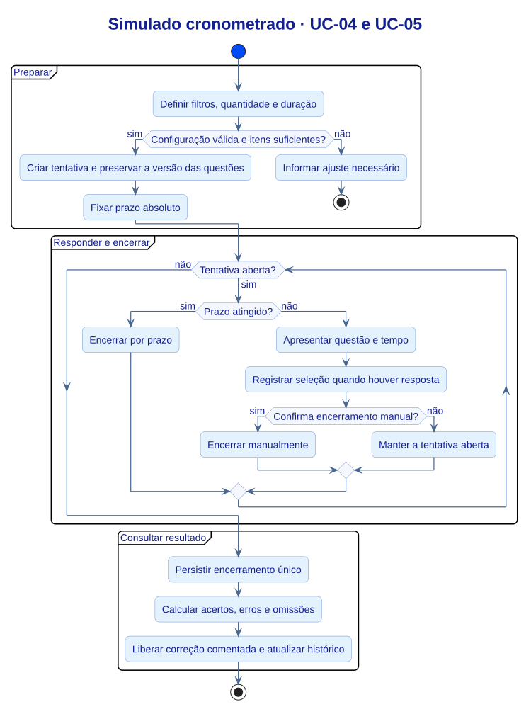
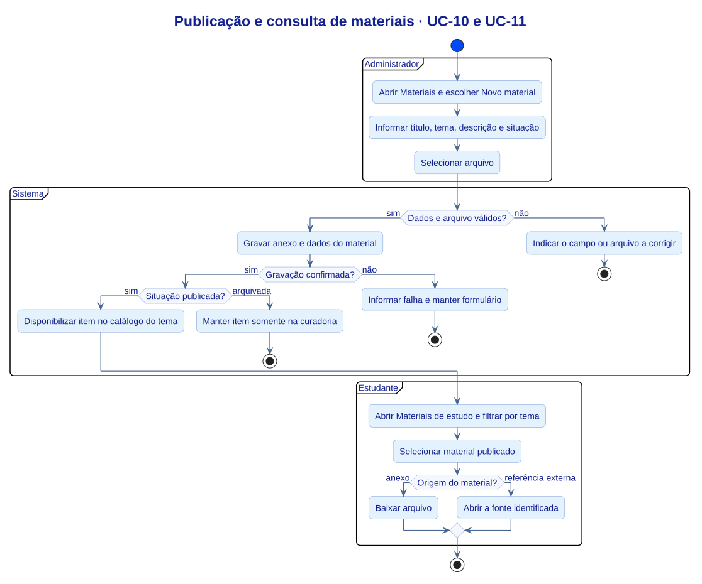

# Diagrama de atividades

> Versão 2.2 · 06/11/2026 · Grupo 2

As visões mostram as decisões de prazo e encerramento do simulado e os pontos de validação, salvamento e publicação de materiais.

### Simulado cronometrado · UC-04 e UC-05

[Editar em PlantUML](UML/Atividades.puml)

### Publicação e consulta de materiais · UC-10 e UC-11

[Editar em PlantUML](UML/AtividadesMateriais.puml)

[Índice de modelagem](UML/README.md)
