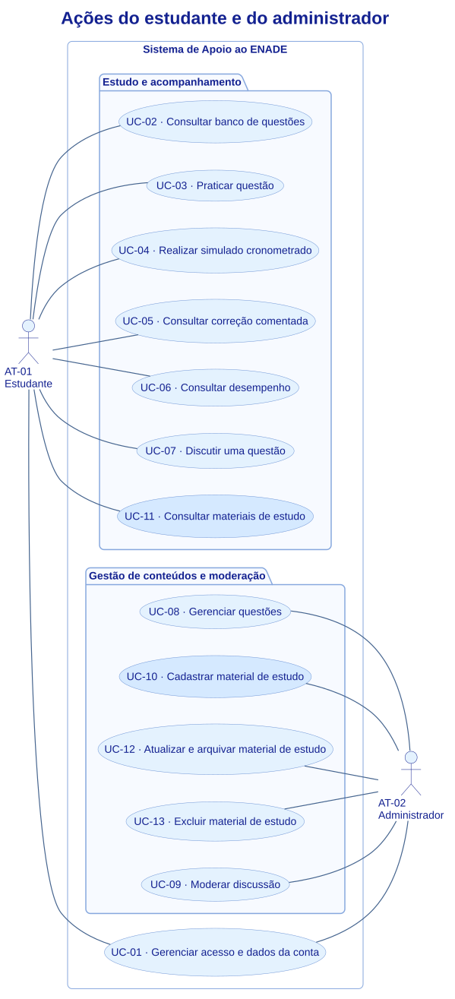

# Diagrama de casos de uso

> Versão 2.2 · 06/11/2026 · Grupo 2

Os casos em destaque separam o cadastro administrativo da consulta do estudante. A manutenção inclui arquivamento e exclusão confirmada. Os fluxos e exceções estão na [especificação](CasosDeUso.md).

### Ações do estudante e do administrador

[Editar em PlantUML](UML/CasosDeUso.puml)

[Índice de modelagem](UML/README.md)
