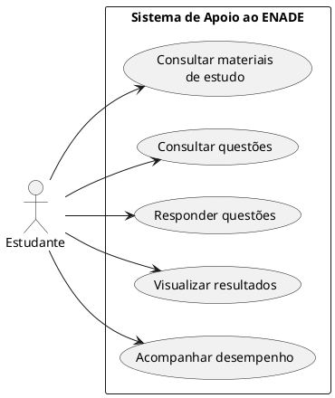

# Diagrama de Casos de Uso — Sistema de Apoio ao ENADE

## Objetivo
Representar as funcionalidades do sistema do ponto de vista dos seus usuários.

## Diagrama UML

## Descrição
O estudante interage com o sistema para consultar materiais de estudo, acessar e responder questões, visualizar resultados e acompanhar seu desempenho.

**Observação:** o diagrama apresenta uma proposta inicial dos casos de uso, que deverá ser validada pelo grupo.