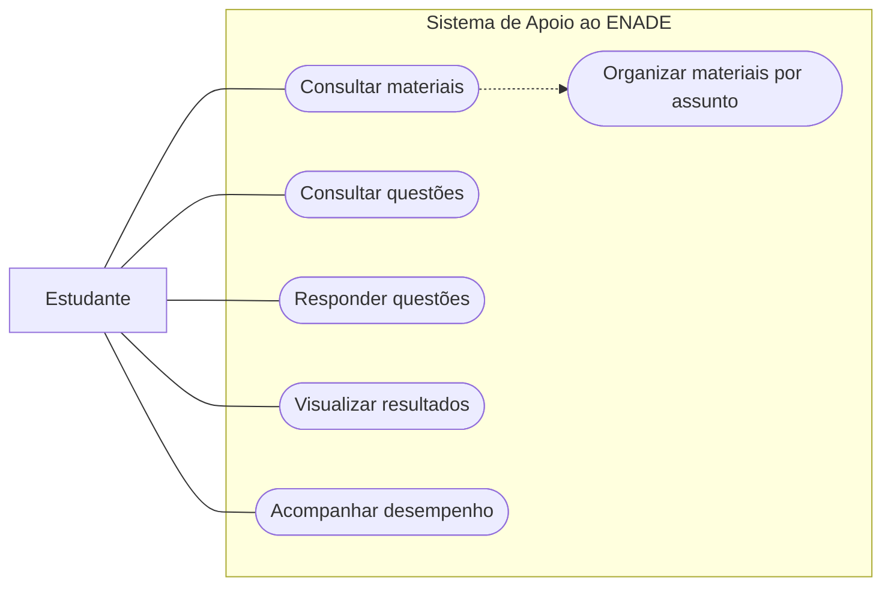

# Diagrama de Casos de Uso — Sistema de Apoio ao ENADE

**Projeto:** Sistema de Apoio ao ENADE  
**Equipe:** Grupo 2  
**Data:** 27/10/2026  
**Versão:** 1.0  
**Status:** Rascunho para revisão do grupo

## 1. Objetivo

Representar as interações entre o estudante e as principais funcionalidades propostas para o Sistema de Apoio ao ENADE.

## 2. Atores

- **Estudante:** consulta materiais de estudo, acessa questões, responde exercícios e acompanha seus resultados.

## 3. Diagrama

## 4. Descrição dos casos de uso

| Código | Caso de uso | Descrição |
|---|---|---|
| CDU-01 | Consultar materiais | Permite ao estudante visualizar os materiais de estudo disponíveis. |
| CDU-02 | Organizar materiais por assunto | Permite localizar materiais organizados por assunto ou categoria. |
| CDU-03 | Consultar questões | Permite visualizar questões para praticar os conteúdos estudados. |
| CDU-04 | Responder questões | Permite selecionar respostas para as questões disponíveis. |
| CDU-05 | Visualizar resultados | Permite consultar o resultado após concluir uma atividade. |
| CDU-06 | Acompanhar desempenho | Permite consultar informações sobre o desempenho nas atividades realizadas. |

## 5. Observações

Este diagrama é uma proposta inicial. O formato utilizado é um fluxograma Mermaid para representar visualmente os atores e as funcionalidades. Antes da entrega, a equipe deverá avaliar se o professor exige especificamente a notação UML de casos de uso, com atores em formato de boneco e elipses para os casos de uso.

## 6. Pendências para revisão

- [ ] Validar os casos de uso com o Grupo 2.
- [ ] Conferir a correspondência com os requisitos funcionais.
- [ ] Confirmar a notação exigida pelo professor.
- [ ] Ajustar o diagrama após a revisão da equipe.
