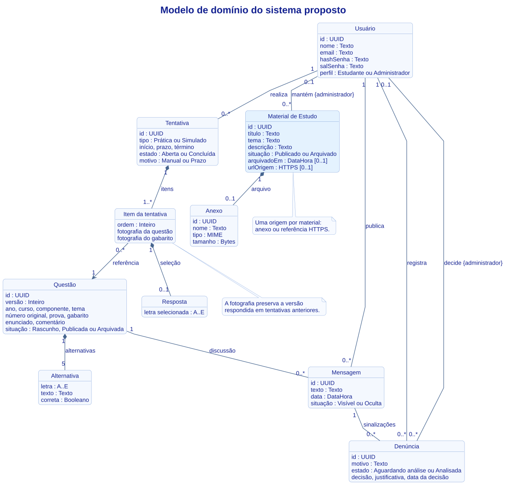

# Diagrama de classes

> Versão 2.2 · 06/11/2026 · Grupo 2

O modelo preserva a fotografia da questão por tentativa e representa as duas formas de origem de um material. Os campos da entrega estão na [SRS](SRS.md).

### Modelo de domínio do sistema proposto

[Editar em PlantUML](UML/Classes.puml)

[Índice de modelagem](UML/README.md)
