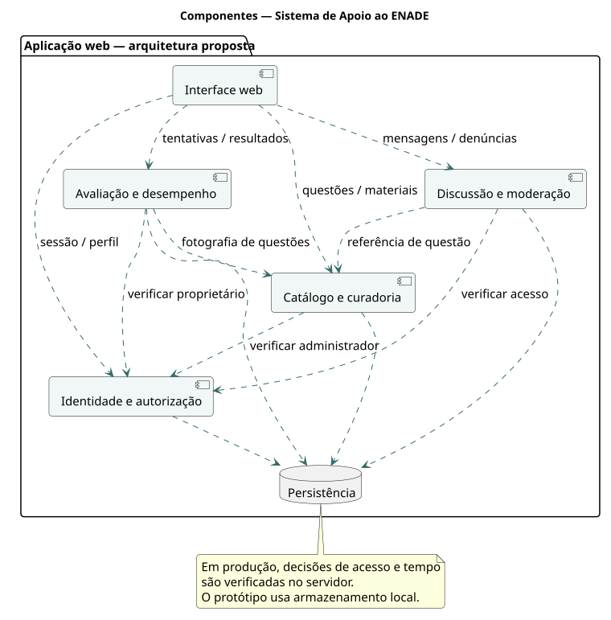

# Diagrama de componentes

> Versão 2.2 · 06/11/2026 · Grupo 2

A gestão de conteúdos atualiza o catálogo. O catálogo oferece questões publicadas para prática e simulado e disponibiliza materiais por tema.

### Responsabilidades e dependências da arquitetura proposta

[Editar em PlantUML](UML/Componentes.puml)

[Índice de modelagem](UML/README.md)
