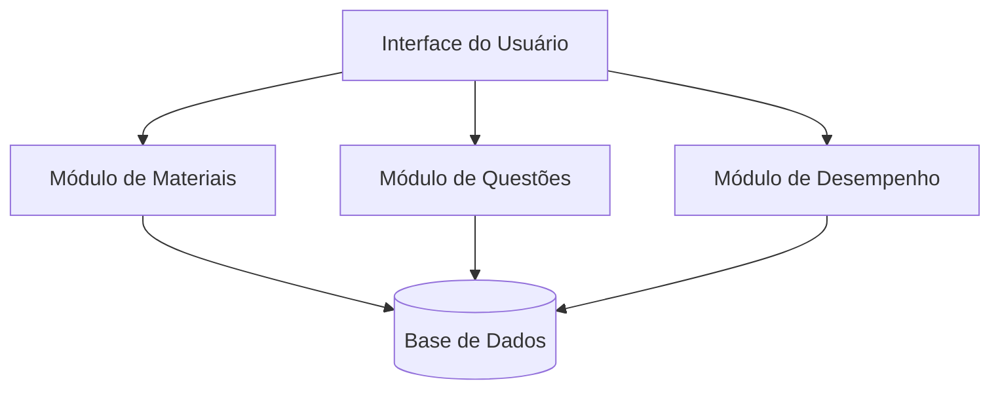

# Diagrama de Componentes — Sistema de Apoio ao ENADE

## Objetivo
Representar os principais componentes do sistema e como eles se relacionam.

## Diagrama

## Descrição dos componentes

- **Interface do Usuário:** permite a navegação e a interação com o sistema.
- **Módulo de Materiais:** organiza e disponibiliza materiais de estudo.
- **Módulo de Questões:** permite consultar e responder questões.
- **Módulo de Desempenho:** apresenta os resultados e o progresso do estudante.
- **Base de Dados:** armazena materiais, questões, respostas e resultados.

**Observação:** este é um modelo inicial para discussão do grupo. A arquitetura deverá ser ajustada conforme as decisões do projeto.