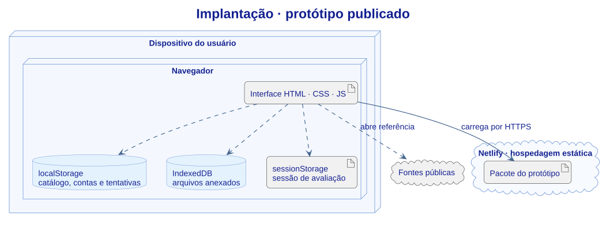

# Diagrama de Implantação

Versão 2.0 · 03/11/2026. Modelo proposto, alinhado à [SRS](SRS.md) e aos [casos de uso](CasosDeUso.md).

[Arquivo editável PlantUML](UML/Implantacao.puml). O modelo descreve o produto conceitual; limites do protótipo estão documentados separadamente.
