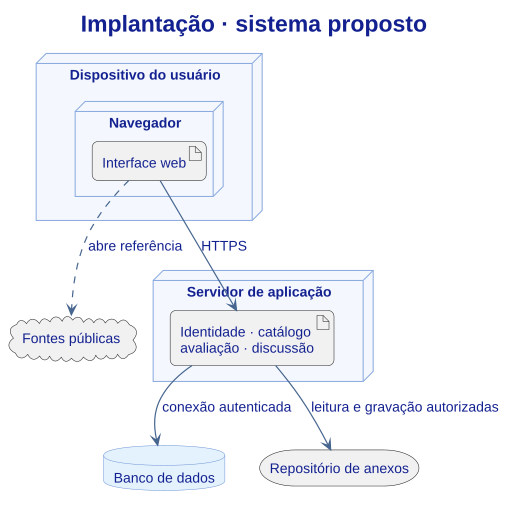

# Diagrama de implantação

> Versão 2.2 · 06/11/2026 · Grupo 2

### Protótipo publicado

O Netlify serve a interface por HTTPS. Contas, tentativas e metadados do catálogo permanecem no navegador. Os arquivos anexados ficam no IndexedDB da mesma origem.

[Editar em PlantUML](UML/Implantacao.puml)

### Sistema proposto

A aplicação de produção prevê autorização no servidor, banco de dados e repositório de anexos compartilhado.

[Editar em PlantUML](UML/ImplantacaoProposta.puml)

[Índice de modelagem](UML/README.md)
