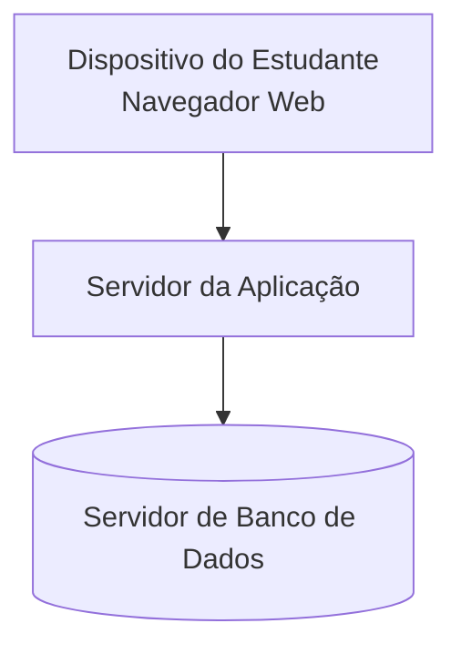

# Diagrama de Implantação — Sistema de Apoio ao ENADE

## Objetivo
Representar os dispositivos e ambientes nos quais o sistema poderá ser executado.

## Diagrama

## Descrição dos elementos

- **Dispositivo do Estudante:** computador, tablet ou celular utilizado para acessar o sistema pelo navegador.
- **Servidor da Aplicação:** ambiente responsável por executar a aplicação e processar as solicitações dos usuários.
- **Servidor de Banco de Dados:** ambiente responsável por armazenar os dados do sistema.

**Observação:** este é um modelo conceitual inicial. A infraestrutura definitiva será definida conforme a arquitetura escolhida pelo grupo.