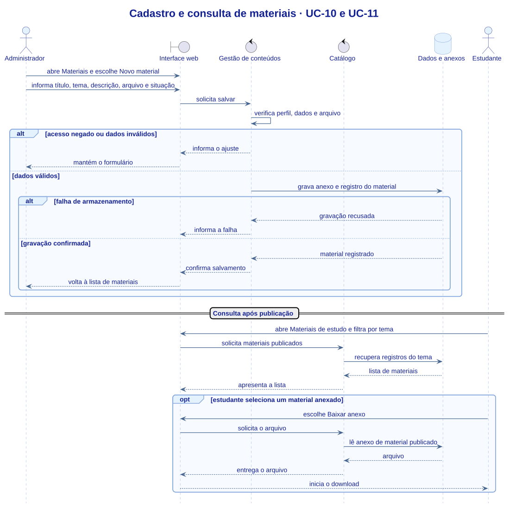

# Diagrama de sequência

> Versão 2.2 · 06/11/2026 · Grupo 2

A primeira visão descreve a arquitetura proposta para o simulado. A segunda detalha o cadastro e a consulta de um material publicado. Na demonstração, os dados e arquivos estão no navegador.

### Simulado cronometrado e correção · UC-04 e UC-05

[Editar em PlantUML](UML/Sequencia.puml)

### Cadastro e consulta de materiais · UC-10 e UC-11

[Editar em PlantUML](UML/SequenciaMateriais.puml)

[Índice de modelagem](UML/README.md)
