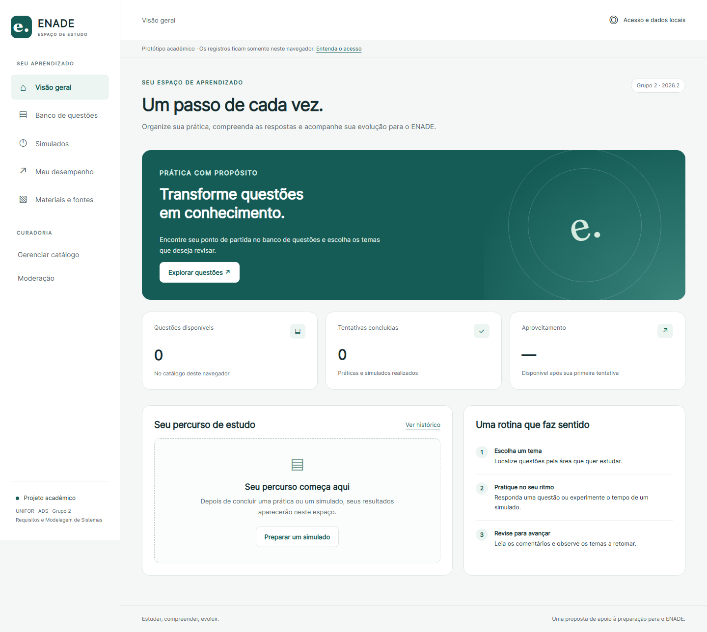
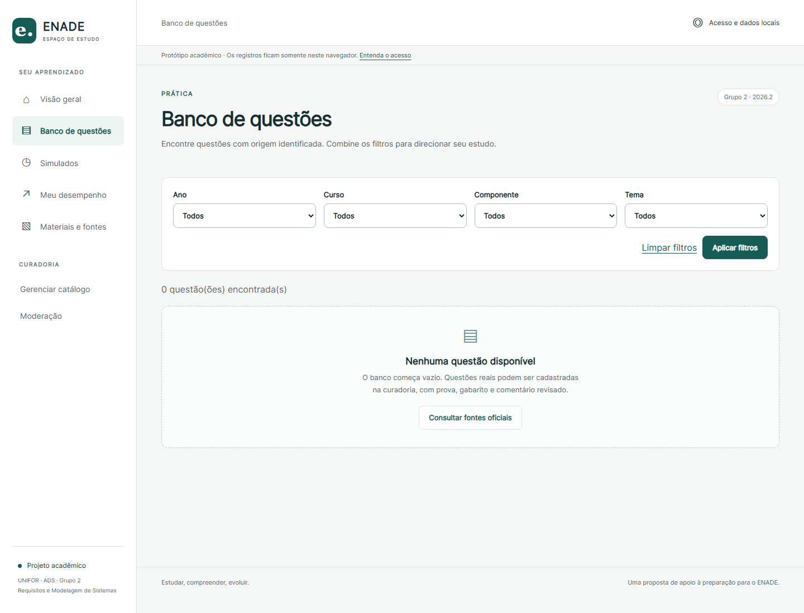
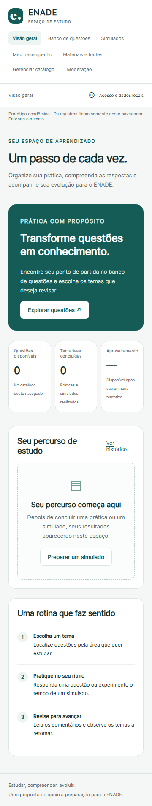

# Protótipo navegável

Versão 2.0 · 03/11/2026 · Grupo 2.

## Abrir e navegar

Baixe o repositório e abra [index.html](index.html) diretamente em Chrome, Edge ou Firefox. A execução não depende de servidor, pacote ou conexão de rede; somente links para fontes externas dependem de internet. No GitHub, o HTML é exibido como código: baixe os arquivos para navegar. Este endereço identifica o artefato versionado; não existe hospedagem pública configurada nesta entrega.

[Wireframes](Wireframes.md) · [Capturas da interface](#capturas) · [Especificação do produto](../SRS.md).

## Origem dos dados

O banco começa vazio. Não há contas, notas ou comentários pré-cadastrados. As referências do Inep exibidas na tela de materiais são links oficiais consultados durante a análise documental. Não há extração automática dos PDFs nem afirmação de que o conteúdo dos documentos vinculados foi importado ou revisado.

O formulário de curadoria permite registrar conteúdo real após conferência. Sem a confirmação de revisão, a questão fica em rascunho. Resultados são calculados com base nas respostas dadas pelo usuário e no gabarito cadastrado. Isso verifica a aplicação da regra, não a qualidade pedagógica ou autenticidade do conteúdo inserido.

## Fluxos implementados e limites

| Fluxo | Disponível no protótipo | Limite em relação ao produto |
| --- | --- | --- |
| UC-01 — Acesso e dados | Seleção de perfil para avaliação; retorno ao estudante; apagar dados locais com confirmação | Não cria conta, não autentica, não recebe senha e não aplica autorização de servidor. |
| UC-02 — Consulta | Filtros combinados por ano, curso, componente e tema; links oficiais e estados vazios | Materiais ficam restritos às fontes documentais da entrega; manutenção de materiais é requisito futuro. |
| UC-03 — Prática | Seleção de uma alternativa, envio, correção e histórico local | Isolado no navegador, sem conta individual de servidor. |
| UC-04 — Simulado | Tema, quantidade, duração, navegação, persistência de prazo, retomada e encerramento manual ou por tempo | Usa relógio local; a produção deverá validar o prazo no servidor. |
| UC-05 — Correção | Acertos, erros, omissões, comentário e referências; fotografia preservada | Gabarito está presente no código/armazenamento local; o protótipo não é ambiente de prova protegida. |
| UC-06 — Desempenho | Histórico, gráfico e tabela por tema, denominadores e ausência de dados | Agrega somente as tentativas deste navegador; não representa indicadores de turma. |
| UC-07 — Discussão | Mensagens locais por questão e denúncia com motivo | Não é comunidade compartilhada; autoria é identificada como registro local. |
| UC-08 — Curadoria | Cadastro, revisão/publicação de rascunho e arquivamento | Não há edição de uma questão publicada: arquive e cadastre a revisão; não há revisão pedagógica automática. |
| UC-09 — Moderação | Fila local, justificativa e decisão de manter/ocultar | Sem equipe institucional ou comunicação entre pessoas. |

## Roteiro de avaliação

1. Abra a visão geral e confira os estados vazios.
2. Navegue pelo banco, simulados, desempenho e fontes, sem cadastrar conteúdo.
3. Em Acesso e dados locais, escolha o perfil de administrador.
4. Consulte uma prova e seu gabarito oficiais, confira as condições de uso e prepare um comentário pedagógico. Cadastre uma questão objetiva com todos os campos; salve em rascunho caso a revisão ainda não tenha ocorrido.
5. Após conferência, publique a questão. No banco, aplique filtros e responda à questão.
6. Consulte correção e desempenho. Confira o denominador e a fonte.
7. Inicie um simulado com quantidade disponível e duração entre 1 e 240 minutos. Responda, atualize a página e confirme que o prazo não reiniciou. Encerre e revise o resultado.
8. Registre uma mensagem, denuncie e avalie a moderação pelo perfil administrativo.
9. Arquive a questão e confirme que o resultado anterior continua íntegro.
10. Apague os dados locais após a avaliação se estiver usando navegador compartilhado.

O usuário fornece conteúdo real para os passos que dependem de questões. Os testes técnicos automatizados usam dados mínimos de ensaio em memória, isolados do catálogo distribuído.

## Persistência e privacidade

Os dados usam localStorage quando permitido. O navegador pode remover registros; navegação privada e abertura por arquivo podem restringir persistência. Se a gravação falhar, a interface informa uso apenas em memória. O armazenamento é por navegador/origem, não por pessoa autenticada. Não utilize dados sensíveis e não trate a seleção de perfil como controle de segurança.

## Capturas

As capturas mostram o estado inicial, sem dados de participantes.

