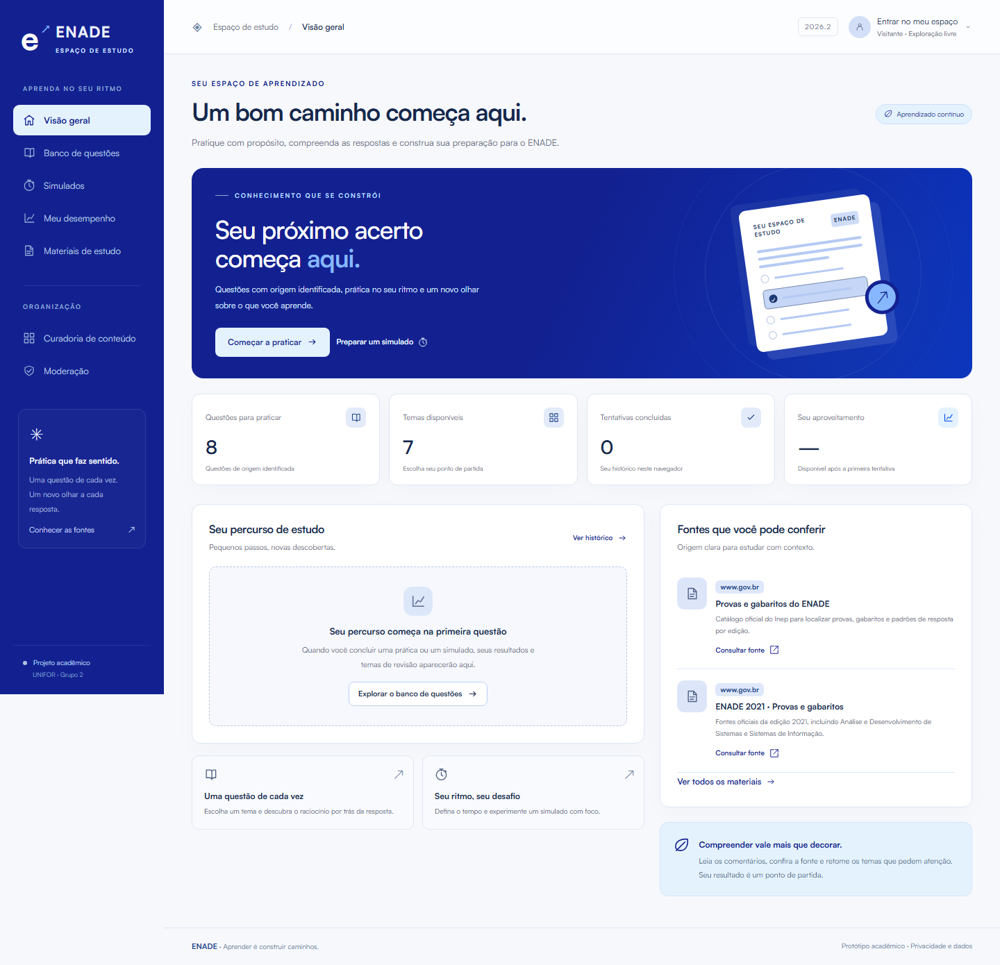
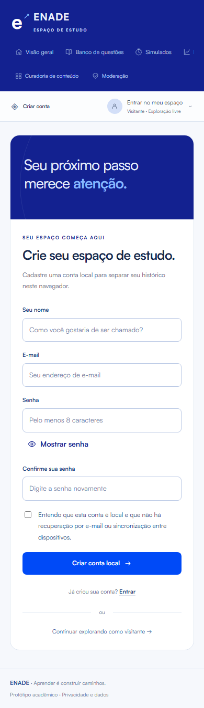

# Protótipo navegável — Espaço de estudo ENADE

Versão 3.1 · 06/11/2026 · UNIFOR · Grupo 2.

**[Abrir o protótipo público](https://enade-grupo2-estudo.netlify.app)**

O professor pode navegar diretamente pelo endereço, sem baixar arquivos ou instalar pacotes. O código versionado está em [index.html](index.html). Como alternativa local, abra esse arquivo mantendo os demais arquivos e a pasta assets ao lado. Use a versão HTTPS para avaliar o cadastro e o armazenamento de anexos.

[Telas e wireframes de alta fidelidade](Wireframes.md) · [Identidade visual](IdentidadeVisual.md) · [Conteúdo e fontes](ConteudoEFontes.md) · [SRS](../SRS.md).

## Conteúdo disponível

A seleção inicial contém oito adaptações textuais de questões reais de Formação Geral e Componente Específico do ENADE, das edições 2017 e 2021, nas áreas de Análise e Desenvolvimento de Sistemas e Sistemas de Informação. Provas, números e respostas foram confrontados com os documentos oficiais do Inep. Cada questão identifica a adaptação, a prova e o gabarito; os hashes dos arquivos consultados estão em [content.json](content.json).

Os comentários são análise técnica do projeto. Não há contas, mensagens ou notas de participantes pré-cadastradas. Os indicadores são calculados exclusivamente com as respostas realizadas por quem navega.

## Fluxos e limites

| Caso de uso | Disponível | Limite do protótipo |
| --- | --- | --- |
| UC-01 — Acesso e dados | Cadastro, confirmação de senha, login, saída, separação de histórico por conta, exclusão de conta e limpeza de dados com confirmação | Contas locais ao navegador; sem recuperação por e-mail, servidor de identidade ou autorização institucional. |
| UC-02 — Banco de questões | Busca por título, enunciado, tema, curso ou número e quatro filtros combináveis | A seleção inicial cobre dois anos, dois cursos e os dois componentes. |
| UC-03 — Prática | Questão com cinco alternativas, bloqueio de envio vazio, correção e histórico | Registros locais; não é aplicação de avaliação oficial. |
| UC-04 — Simulado | Quatro filtros, contagem de questões disponíveis, quantidade, duração, navegação, retomada, prazo persistente e encerramento manual ou automático | Seleção determinística das primeiras questões filtradas; relógio do dispositivo. |
| UC-05 — Correção | Acertos, erros e omissões; comentários, fonte e fotografia da versão respondida | Gabarito acessível no código local; não é ambiente de prova protegida. |
| UC-06 — Desempenho | Histórico por perfil, gráfico e tabela por tema com denominadores | Nenhum indicador de turma ou integração institucional. |
| UC-07 — Discussão | Mensagem por questão e sinalização com motivo | Mensagens locais, sem comunicação entre pessoas. |
| UC-08 — Gestão de questões | Cadastro, edição com versão, rascunho, publicação e arquivamento | Modo Avaliar curadoria. |
| UC-09 — Moderação | Sinalizações, decisão de manter/ocultar e justificativa | Fila local, sem equipe de moderação conectada. |
| UC-10 — Cadastrar material de estudo | Anexar um arquivo com título, tema, descrição e situação | O arquivo fica no navegador. |
| UC-11 — Consultar materiais de estudo | Filtrar por tema, baixar anexos e abrir referências externas | Os anexos são acessíveis na biblioteca do mesmo navegador. |
| UC-12 — Atualizar e arquivar material | Editar dados, substituir o anexo e arquivar | A edição conserva a origem existente quando nenhum novo arquivo é selecionado. |
| UC-13 — Excluir material de estudo | Remover o item e seu anexo mediante confirmação | Exclusão na biblioteca deste navegador. |

## Percurso para avaliação

1. Abra o endereço público e entre no **Banco de questões**. Filtre por **Formação Geral**.
2. Abra uma questão, responda e confira a **Correção comentada** com o gabarito e a fonte oficial.
3. Em **Meu desempenho**, confira a tentativa e os indicadores por tema.
4. Para testar prazo e retomada, configure um **Simulado**, responda, recarregue a página e conclua.

### Anexar e consultar um material

1. Abra **Curadoria de conteúdo**, escolha **Avaliar curadoria** e confirme.
2. Em **Materiais**, clique em **Novo material** e preencha título, tema e descrição.
3. Anexe um PDF, PNG, JPG, WebP, GIF, DOCX, PPTX ou XLSX de até 15 MB. Use um arquivo próprio ou autorizado.
4. Mantenha a situação **Publicado** e salve. Abra **Materiais de estudo**, filtre pelo tema e escolha **Baixar anexo**.
5. Use **Arquivar** para retirar o material da biblioteca e manter o cadastro, o anexo e a data no histórico da curadoria. Use **Excluir** e confirme para remover o item e seu anexo deste navegador.

O protótipo guarda os arquivos e os dados no navegador de avaliação. O cadastro confere a estrutura de PDFs e arquivos Office e a leitura de imagens. As referências oficiais incluídas na biblioteca continuam acessíveis por link.

## Dados e manutenção

Contas e metadados do catálogo usam localStorage. Arquivos anexados usam IndexedDB e a sessão usa sessionStorage. A senha é derivada com PBKDF2/SHA-256, 120 mil iterações e sal aleatório, sem armazenamento da senha em texto simples. Isso permite avaliar o fluxo e não substitui autenticação e autorização de servidor. Perfis compartilham o catálogo local e mantêm seus históricos separados. No site HTTPS, as abas compartilham os registros e coordenam gravações no mesmo navegador.

Limpeza do navegador, navegação privada e restrições de armazenamento podem remover os registros. A interface informa falha de gravação. Não há sincronização entre dispositivos. O modo de curadoria não protege dados contra quem utiliza o mesmo navegador.

O conteúdo inicial é mantido em content.json; **node scripts/build-content.mjs**, na raiz do repositório, atualiza content.js. O pacote não precisa de build para executar. Confira [Verificação técnica](../VerificacaoTecnica.md) e [Publicação](Publicacao.md) para os procedimentos de manutenção.

## Prévia

Todas as telas estão em [Wireframes.md](Wireframes.md). Capturas de correção e desempenho documentam ações de verificação técnica.
