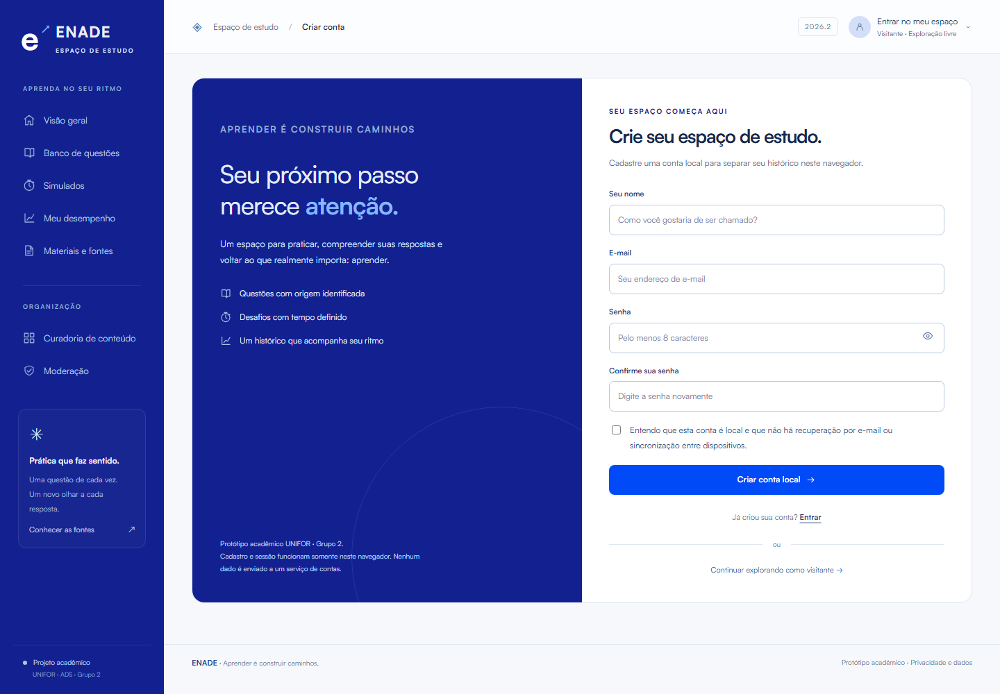
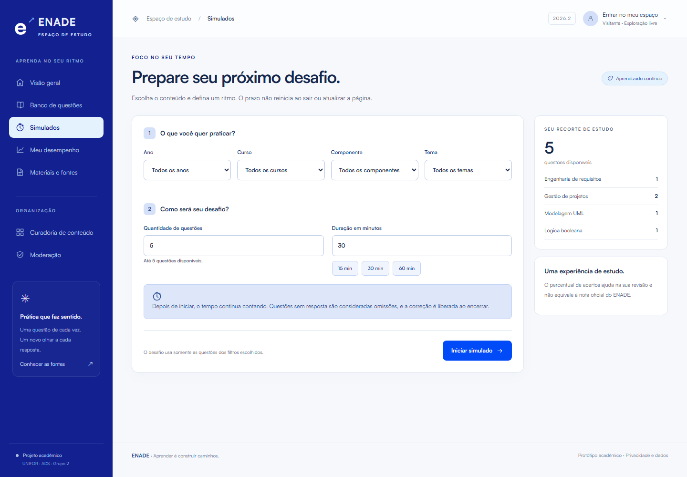
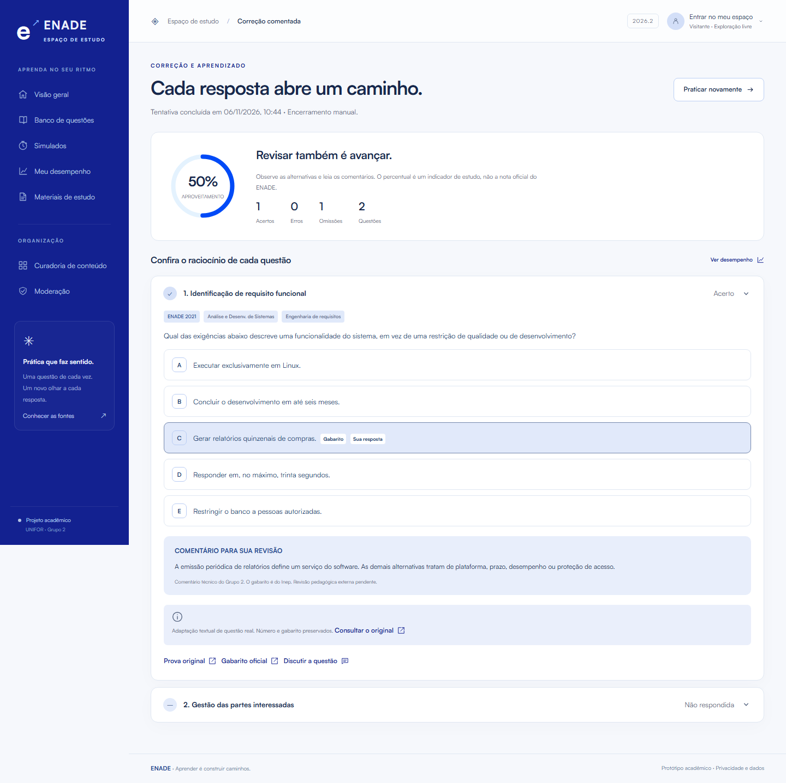

# Wireframes e telas de alta fidelidade

Versão 3.0 · 03/11/2026. Telas capturadas do HTML executável, com navegação, componentes, tipografia, cores e estados implementados. Substituem os esquemas de baixa fidelidade da versão anterior.

**[Navegar no protótipo público](https://enade-grupo2-estudo.netlify.app)** · [Identidade visual UNIFOR](IdentidadeVisual.md).

## Mapa das telas

| Tela | Fluxo | Captura |
| --- | --- | --- |
| Visão geral | Entrada, catálogo e indicadores locais | [Computador](capturas/01-inicio.png) · [Celular](capturas/15-inicio-mobile.png) |
| Login | UC-01 | [Entrar](capturas/02-login.png) |
| Cadastro | UC-01 | [Computador](capturas/03-cadastro.png) · [Celular](capturas/17-cadastro-mobile.png) |
| Banco e filtros | UC-02 | [Computador](capturas/04-banco.png) · [Celular](capturas/16-banco-mobile.png) |
| Prática individual | UC-03 | [Questão e alternativas](capturas/05-questao.png) |
| Preparação | UC-04 | [Computador](capturas/06-preparacao.png) · [Celular](capturas/18-preparacao-mobile.png) |
| Simulado em andamento | UC-04 | [Prazo, respostas e navegação](capturas/07-simulado.png) |
| Correção | UC-05 | [Resultado e referências](capturas/08-correcao.png) |
| Desempenho | UC-06 | [Indicadores e tabela por tema](capturas/09-desempenho.png) |
| Materiais | UC-02 | [Biblioteca e fontes](capturas/10-materiais.png) |
| Curadoria de questões | UC-08 | [Lista e ações](capturas/11-curadoria.png) |
| Edição de questão | UC-08 | [Campos, gabarito e conferência](capturas/12-editar-questao.png) |
| Curadoria de materiais | UC-08 | [Lista e ações](capturas/13-curadoria-materiais.png) |
| Cadastro de material | UC-08 | [Formulário](capturas/14-editar-material.png) |

UC-07 e UC-09 são avaliados pelas telas de discussão e moderação no protótipo. Não há mensagens de participantes pré-cadastradas para preencher essas telas.

## Comportamento visual

A navegação lateral torna-se superior em celular; listas e formulários se reorganizam em coluna única. Campos têm rótulos visíveis, foco de teclado e feedback de validação. Diálogos confirmam encerramento, curadoria, arquivamento e exclusões. O desempenho tem uma tabela equivalente ao gráfico.

As telas de correção e desempenho foram obtidas após uma resposta e um encerramento com omissão durante o ensaio técnico. Documentam o funcionamento da interface, sem constituir resultado de estudante, entrevista ou validação externa.

## Prévia das interfaces

