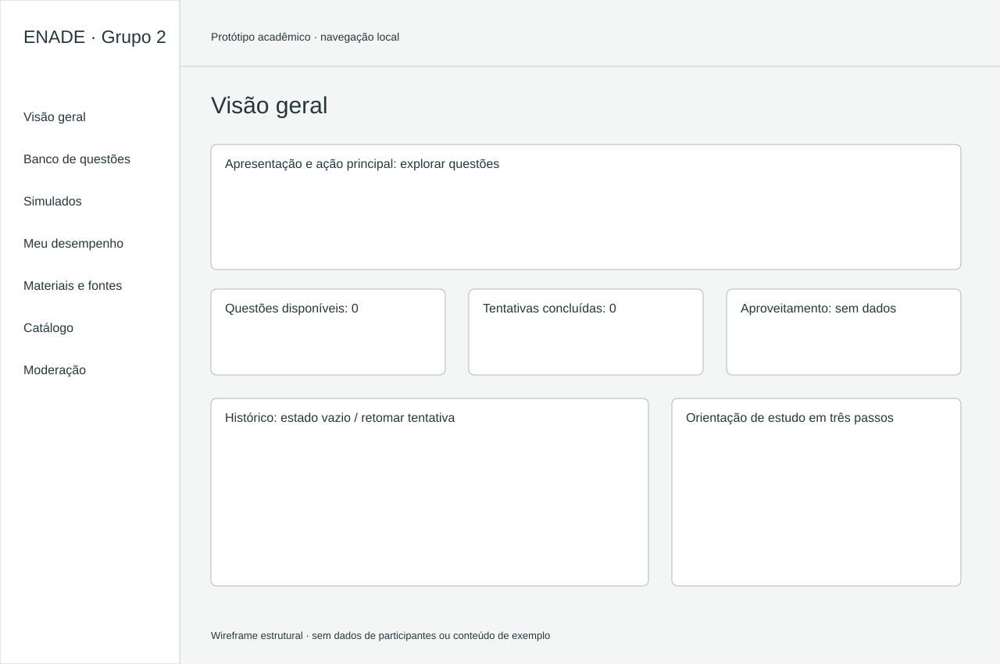
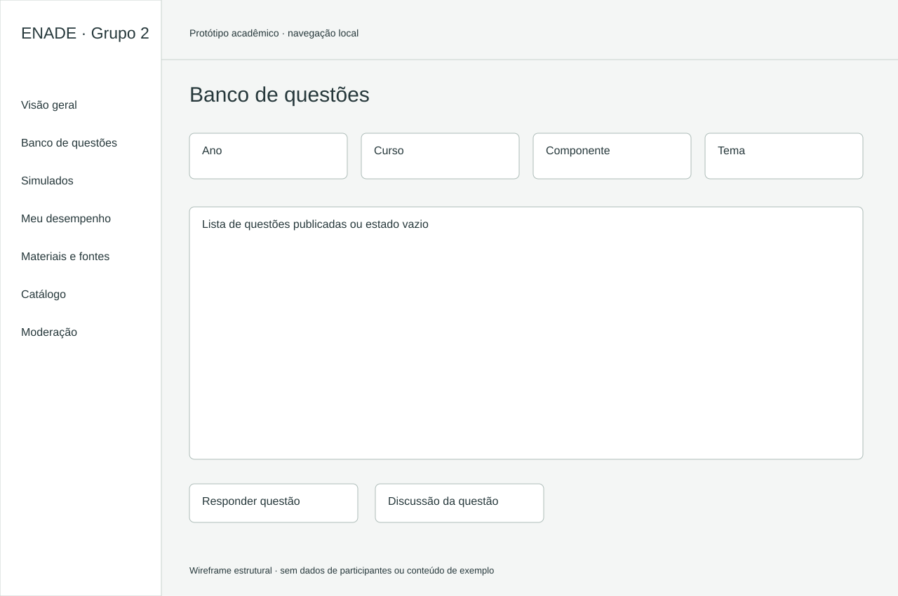
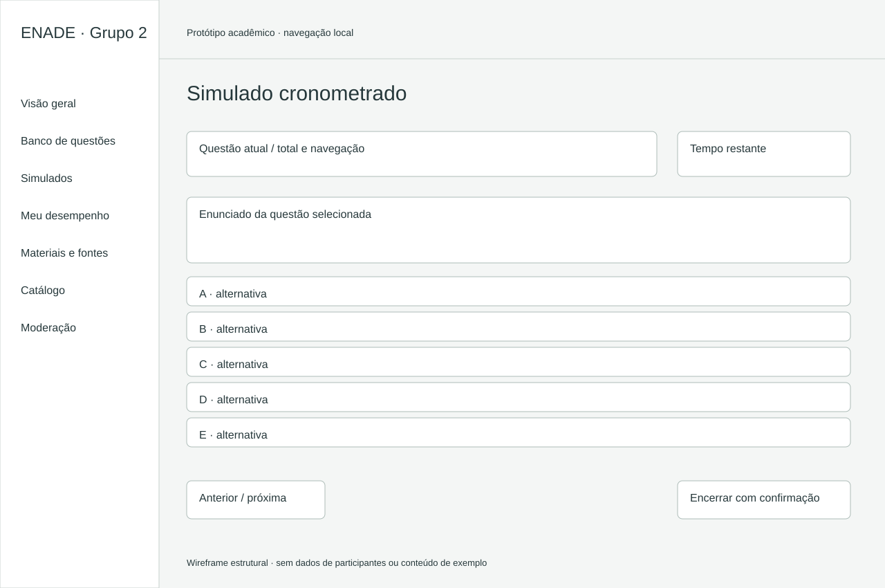
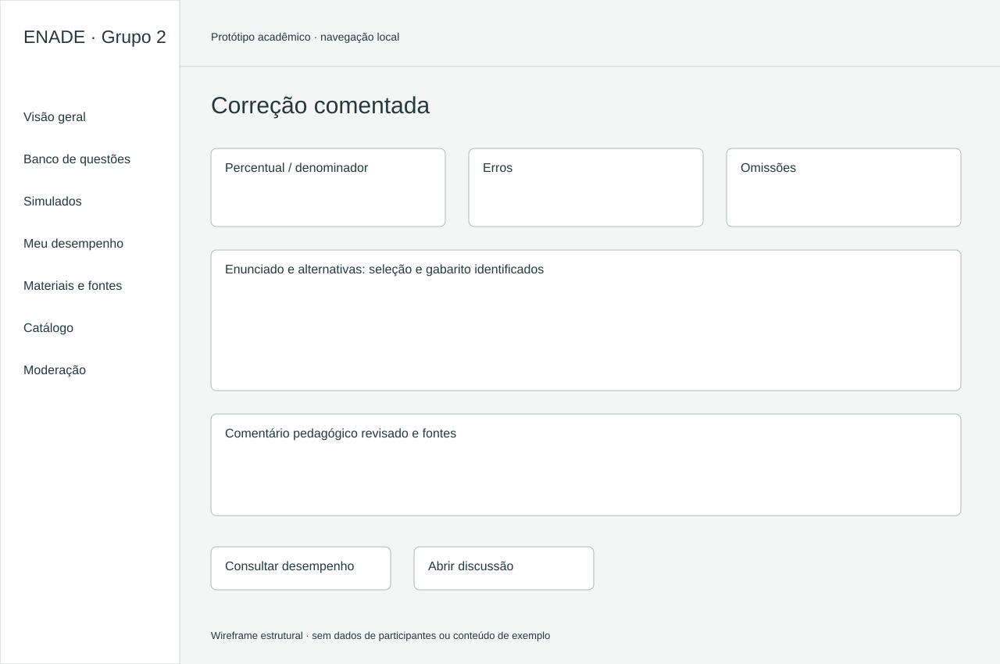
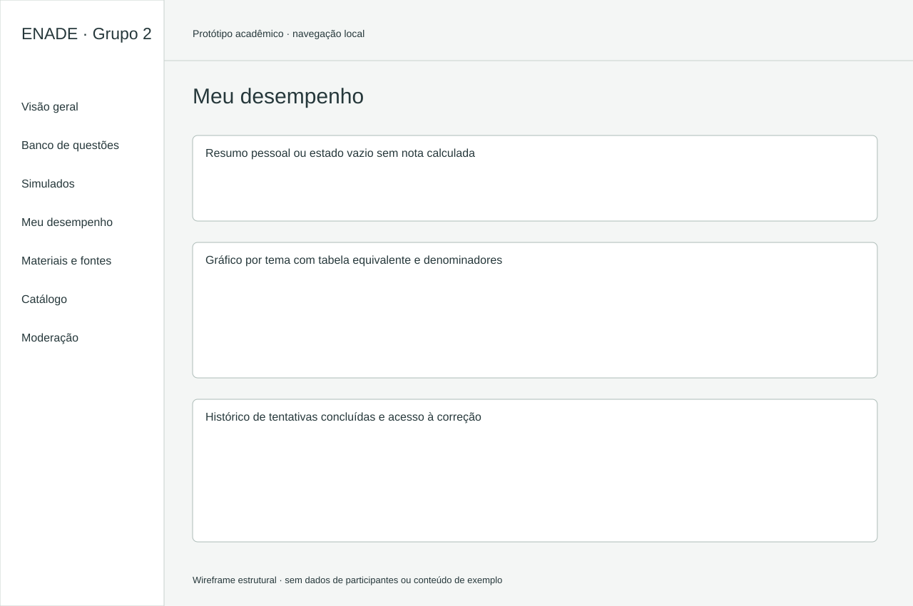
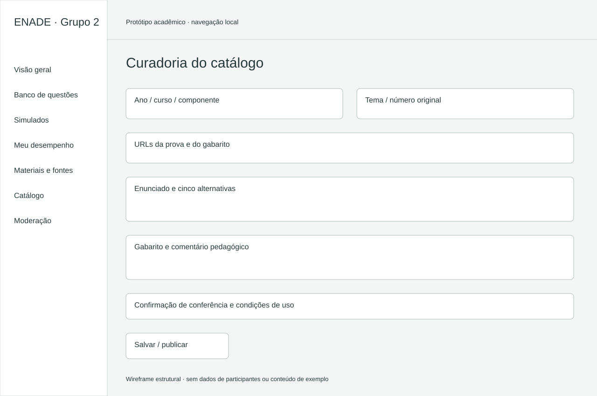
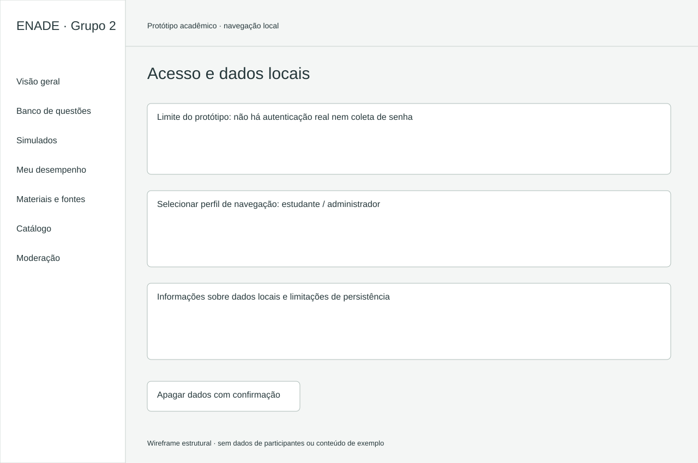

# Wireframes de interface

Versão 2.0 · 03/11/2026. Estruturas de baixa fidelidade para leitura dos fluxos; a interface navegável está em index.html. Os rótulos descrevem campos e estados, sem apresentar entrevistas, usuários ou resultados de exemplo.

## Visão geral

## Banco de questões

## Simulado cronometrado

## Correção comentada

## Meu desempenho

## Curadoria do catálogo

## Acesso e dados locais

## Cobertura

UC-01: acesso; UC-02: banco e fontes; UC-03: questão; UC-04: simulado; UC-05: correção; UC-06: desempenho; UC-07/UC-09: discussão e moderação no protótipo; UC-08: curadoria. Em telas pequenas, a barra lateral vira navegação superior e os formulários ficam em coluna única.
